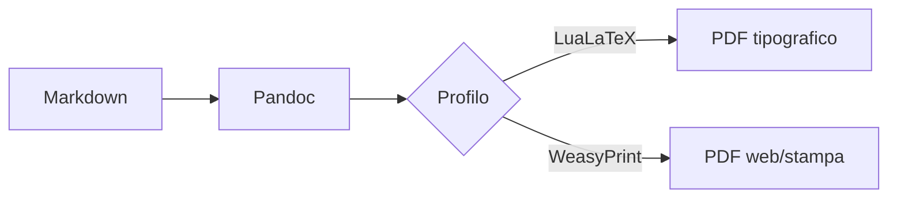

# Relazione trimestrale MARK_TITLE

Questo documento raccoglie lo **stato di avanzamento**, i *rischi* e le decisioni prese nel trimestre. Contiene tabelle di diversa larghezza, blocchi di codice, elenchi annidati, citazioni e un diagramma, così da verificare che l'export sia il gemello della preview.

## Riepilogo esecutivo

> La qualità non è un atto, è un'abitudine. Ogni pagina esportata deve essere indistinguibile dalla pagina vista nell'applicazione.

Punti chiave del periodo:

1. Consegnata la barra dei documenti responsiva.
2. Avviato il PRD v2 con **16 sprint** pianificati.
   - vault e indice locale
   - link, backlink e grafo
   - query e viste
3. Export PDF certificato su tre piattaforme.

- [x] Fix barra tab
- [ ] Refactor del workspace
- [ ] Indice locale

## Tabella di stato a tre colonne

| Area | Stato | Note |
| --- | --- | --- |
| Editor | Stabile | Monaco con wrapping forzato, nessuna scrollbar orizzontale nel flusso di scrittura. |
| Export PDF | In revisione | Le tabelle larghe devono restare dentro la pagina e replicare la resa della preview. |
| Packaging | Certificato | AppImage, deb e rpm in locale; exe e dmg in CI con smoke test dedicati. |

## Tabella numerica a sei colonne

| Mese | Note create | Note modificate | Export PDF | Errori | Tempo medio export (s) |
| --- | ---: | ---: | ---: | ---: | ---: |
| Luglio | 1.240 | 3.871 | 212 | 3 | 4,8 |
| Agosto | 980 | 2.904 | 187 | 1 | 4,6 |
| Settembre MARK_MONTH | 1.512 | 4.420 | 265 | 0 | 4,2 |
| **Totale** | **3.732** | **11.195** | **664** | **4** | **4,5** |

## Tabella larga con testo descrittivo

| Requisito | Descrizione estesa | Responsabile | Priorità | Scadenza | Stato | Riferimento |
| --- | --- | --- | --- | --- | --- | --- |
| Indice incrementale | L'indice deve aggiornarsi entro 100 ms dal salvataggio di una nota, senza bloccare l'interfaccia, anche con vault da diecimila note. | Team core | Alta | 2026-11-15 | In corso | [[V2.4]] |
| Query e viste | Tabella, kanban, calendario e galleria generate da una query salvata in un file Markdown, esportabili nei PDF in forma statica. | Team UI | Alta | 2026-12-20 | Pianificato | [[V2.10]] |
| Canvas MARK_LASTROW | Editor proprio basato sulla specifica JSON Canvas, con nodi testo, note incorporate e frecce etichettate. | Team UI | Media | 2027-01-31 | Pianificato | [[V2.14]] |

## Tabella con identificatori lunghi

| Chiave | Valore |
| --- | --- |
| `config.export.weasy.printStylesheetPath` | `/opt/doku/resources/export-runtime/printStylesheet.css` |
| URL documentazione | https://docs.example.org/doku/export/pdf/weasyprint/profili-e-margini-di-rilegatura |
| Hash commit | 61beebe3f1c9a7d4b2e8f0a6c5d4e3f2a1b0c9d8e7f6a5b4c3d2e1f0a9b8c7d6 |

## Codice

```typescript
export function resolvePdfTypography(input: DokuTypography | undefined): DokuTypography {
  const typography = input ?? DEFAULT_DOKU_TYPOGRAPHY;
  return { ...typography, pdfFontFamily: typography.uiFontFamily, accessibilityMode: false };
}
```

Il comando `npm run package:linux:all` costruisce e certifica i binari Linux.

```bash
xvfb-run -a npx playwright test tests/e2e/pdf-preview-parity.spec.js --reporter=list
```

## Diagramma



## Immagine e nota a piè di pagina

Il logo è incorporato come asset locale[^1]. Una riga orizzontale separa le sezioni.

---

### Sottosezione con elenco lungo

- Primo punto con una frase abbastanza lunga da andare a capo almeno una volta nella colonna di testo A4.
- Secondo punto
  - Sottopunto uno
  - Sottopunto due con `codice inline` e un [link](https://example.org)
- Terzo punto

#### Titolo di quarto livello

Testo finale del documento con una parola lunghissima: pneumonoultramicroscopicsilicovolcanoconiosisultramicroscopica.

[^1]: Nota a piè di pagina MARK_FOOTNOTE con testo esplicativo.
